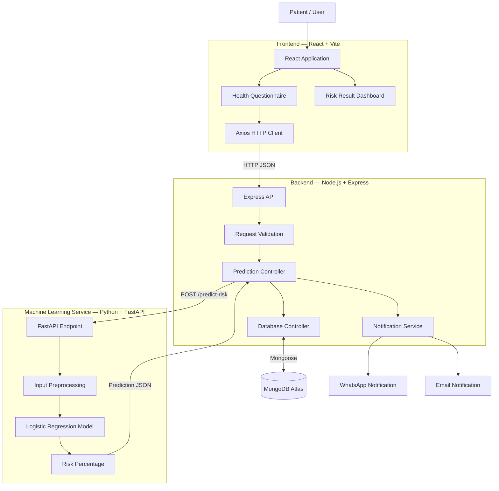
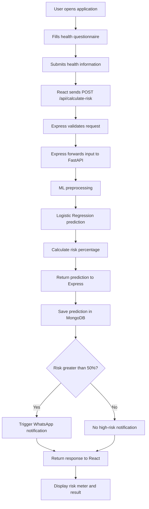
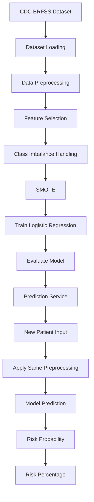
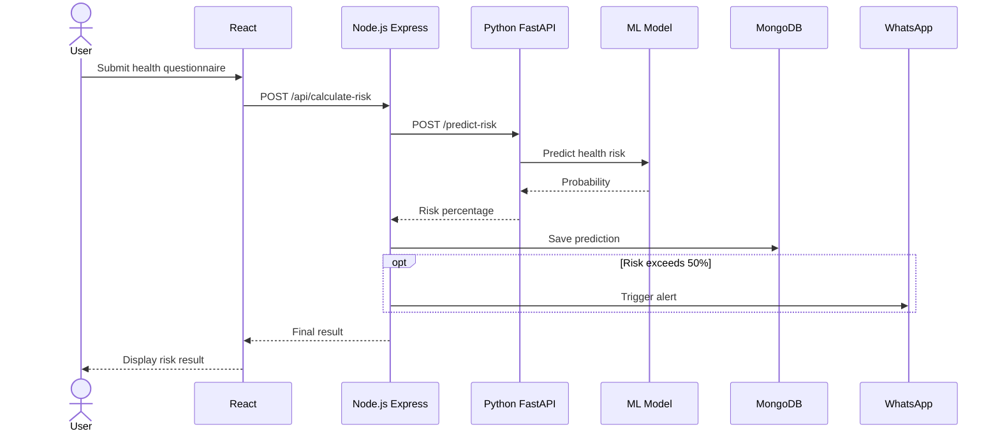

# 🩺 AI-Powered Diabetes Risk Predictor & Patient Portal

<div align="center">

**An AI-powered health risk screening platform using Machine Learning, FastAPI, React, and Node.js.**


</div>

---

## 📖 Table of Contents

- [Overview](#-overview)
- [Key Features](#-key-features)
- [System Architecture](#-system-architecture)
- [End-to-End Workflow](#-end-to-end-workflow)
- [Machine Learning Pipeline](#-machine-learning-pipeline)
- [Technology Stack](#-technology-stack)
- [Project Structure](#-project-structure)
- [Prerequisites](#-prerequisites)
- [Installation](#-installation)
- [Running the Application](#-running-the-application)
- [Building the Desktop Application](#-building-the-desktop-application)
- [API Documentation](#-api-documentation)
- [Test Cases](#-test-cases)
- [Security and Privacy](#-security-and-privacy)
- [Troubleshooting](#-troubleshooting)
- [Limitations and Future Improvements](#-limitations-and-future-improvements)
- [Author](#-author)
- [License](#-license)

---

## 🎯 Overview

**AI Health Risk Tracker** is a full-stack health risk screening application that estimates a user's diabetes risk using a Machine Learning model trained on the CDC's Behavioral Risk Factor Surveillance System (BRFSS) dataset.

The project uses a microservice architecture consisting of:

- **React + Vite:** Interactive frontend and patient portal.
- **Node.js + Express:** Main backend, database operations, and notification handling.
- **Python + FastAPI:** Independent Machine Learning prediction service.
- **MongoDB Atlas:** Cloud-based patient record storage.
- **Electron:** Desktop application packaging.

The model uses Logistic Regression to generate a diabetes risk estimate based on health and lifestyle information.

When the predicted risk exceeds the configured threshold of 50%, the backend can trigger a WhatsApp notification. Email notifications can also be configured.

### Key Innovation: Explainable Machine Learning

The project uses Logistic Regression, a model whose coefficients can be examined to understand how input features influence its predictions.

This makes the model more interpretable than many complex black-box approaches.

However, model coefficients do not independently establish medical causation. The risk estimate should be treated as an informational screening result rather than a clinical diagnosis.

### Dataset

| Attribute | Details |
|---|---|
| Dataset | CDC BRFSS 2015 |
| Source | CDC Behavioral Risk Factor Surveillance System |
| Repository identifier mentioned in original implementation | UCI Dataset ID: 891 |
| Number of records | 253,680 |
| Learning algorithm | Logistic Regression |
| Class balancing | SMOTE, as described in the project |
| Prediction output | Risk percentage |

Dataset source: [UCI Machine Learning Repository](https://archive.ics.uci.edu/)

---

## ✨ Key Features

### 🧠 Machine Learning

- Diabetes risk prediction using Logistic Regression.
- Prediction through a dedicated Python FastAPI service.
- Risk percentage returned to the backend.
- Model training using the BRFSS dataset.
- SMOTE-based class balancing, as configured in the ML pipeline.
- Interpretable model coefficients.

### 👨‍⚕️ Patient Portal

- Health questionnaire.
- BMI and lifestyle-related inputs.
- Health risk result visualization.
- Animated risk meter.
- Color-coded risk indicator.
- Patient record storage in MongoDB.

### 📲 Automated Notifications

- WhatsApp notifications using `whatsapp-web.js`.
- QR-code-based WhatsApp authentication.
- Automatic alert when the configured risk threshold is exceeded.
- Optional email notifications using Nodemailer.

### 🖥️ User Interface

- React-based responsive interface.
- Blue-and-white medical theme.
- Animated risk meter.
- Risk indicators.
- Responsive desktop and mobile layouts.

### 🖥️ Desktop Application

- Electron integration.
- Windows executable packaging.
- Dedicated application icon.
- Desktop installation build.

---

## 🏗️ System Architecture

The application follows a **three-service architecture**. Each service has a separate responsibility, allowing the frontend, business logic, and ML prediction engine to operate independently.



### Responsibilities of Each Service

| Service | Technology | Responsibility |
|---|---|---|
| Frontend | React, Vite | Collect health information and display results |
| Backend | Node.js, Express | Handle requests, database operations, and notifications |
| ML API | Python, FastAPI | Preprocess input and generate diabetes risk predictions |
| Database | MongoDB Atlas | Store patient and prediction records |
| Notification | whatsapp-web.js | Send WhatsApp alerts |
| Email | Nodemailer | Send optional email notifications |
| Desktop | Electron | Package the frontend as a Windows application |

---

## 🔄 End-to-End Workflow

The following diagram represents the complete prediction lifecycle.



### Request Lifecycle

1. The user enters health information in the React interface.
2. React sends the information to the Node.js backend.
3. Express validates the request.
4. Express forwards the data to the Python prediction service.
5. FastAPI prepares the input for the trained ML model.
6. Logistic Regression calculates the prediction probability.
7. FastAPI returns the estimated risk percentage.
8. Express stores the prediction in MongoDB.
9. If the result exceeds 50%, the notification service can trigger a WhatsApp alert.
10. Express returns the final result to React.
11. React displays the risk percentage using an animated visualization.

---

## 🧠 Machine Learning Pipeline

The ML service is responsible for processing health-related input and producing a prediction.



### Algorithm: Logistic Regression

Logistic Regression is a supervised Machine Learning algorithm used for classification.

It estimates the probability of a sample belonging to a particular class.

The logistic function is:

\[
P(y=1 \mid x)=\frac{1}{1+e^{-z}}
\]

Where:

\[
z=w_0+w_1x_1+w_2x_2+\cdots+w_nx_n
\]

- \(x_i\): Input feature.
- \(w_i\): Learned model coefficient.
- \(w_0\): Intercept.
- \(P(y=1 \mid x)\): Predicted probability of the positive class.

The probability can be represented as a percentage:

\[
Risk\ Percentage=P(y=1 \mid x)\times100
\]

### Explainability

Logistic Regression coefficients can help indicate how individual features influence the model's prediction.

For example, features such as BMI, physical activity, blood pressure, and dietary habits may contribute to the predicted result.

The effect of each feature depends on the model's learned coefficients and the preprocessing applied to that feature.

**Important:** These feature relationships are statistical model behavior, not proof that an individual lifestyle factor caused a person's diabetes risk.

### Risk Threshold

The current project describes a notification threshold of 50%.

| Risk percentage | Application behavior |
|---|---|
| Below or equal to 50% | Display prediction without high-risk alert |
| Above 50% | Trigger configured notification workflow |

The 50% value is an application threshold, not a medically validated diagnostic boundary.

---

## 💻 Technology Stack

### Frontend

| Technology | Version mentioned | Purpose |
|---|---|---|
| React | 19.2.4 | User interface |
| Vite | 8.0.4 | Development and build tool |
| Electron | 41.4.0 | Desktop application |
| React Router DOM | 7.14.1 | Frontend routing |
| Axios | 1.15.0 | HTTP requests |

### Backend

| Technology | Version mentioned | Purpose |
|---|---|---|
| Node.js | 22.x | JavaScript runtime |
| Express | 4.21 | Backend framework |
| Mongoose | 8.x | MongoDB ODM |
| whatsapp-web.js | Latest | WhatsApp automation |
| qrcode-terminal | Latest | QR code display |
| Nodemailer | Latest | Email delivery |
| dotenv | Latest | Environment configuration |
| cors | Latest | Cross-origin requests |

### Machine Learning

| Technology | Version mentioned | Purpose |
|---|---|---|
| Python | 3.14 | ML runtime |
| FastAPI | 0.115 | Prediction API |
| Uvicorn | Latest | ASGI server |
| scikit-learn | 1.8.0 | Machine Learning |
| pandas | 3.0.2 | Data processing |
| NumPy | 2.4.4 | Numerical operations |
| ucimlrepo | 0.0.7 | Dataset retrieval |

### Database and Dataset

| Technology | Purpose |
|---|---|
| MongoDB Atlas | Cloud database |
| CDC BRFSS 2015 | Machine Learning dataset |

### Desktop

| Technology | Purpose |
|---|---|
| Electron | Desktop application wrapper |
| electron-builder | Windows executable packaging |

---

## 📁 Project Structure

```text
diabities/
│
├── frontend/
│   ├── public/
│   │   └── app-icon.ico
│   │
│   ├── src/
│   │   ├── App.jsx
│   │   ├── App.css
│   │   ├── main.jsx
│   │   └── index.css
│   │
│   ├── electron.cjs
│   ├── vite.config.js
│   ├── package.json
│   └── index.html
│
├── backend/
│   ├── server.js
│   ├── .env
│   └── package.json
│
├── ml_api/
│   ├── main.py
│   ├── requirements.txt
│   └── venv/
│
└── README.md
```

**Note:** The `venv/` and `node_modules/` directories are generated during installation and should not normally be committed to Git.

---

## ⚙️ Prerequisites

Install the following before starting:

| Requirement | Recommended |
|---|---|
| Operating System | Windows 10/11 64-bit |
| Node.js | 22.x |
| npm | Included with Node.js |
| Python | Compatible with your installed ML package versions |
| MongoDB | MongoDB Atlas or local MongoDB |
| RAM | 8 GB minimum; 16 GB recommended |
| Storage | 2 GB free space |
| Internet | Required for initial setup and external services |

Also prepare:

- MongoDB Atlas account.
- WhatsApp account for linking the notification session.
- Gmail account and app password if email notifications are enabled.

---

## 🚀 Installation

### 1. Clone the Repository

```powershell
git clone <YOUR_GITHUB_REPOSITORY_URL>
cd diabities
```

Replace the placeholder with your actual GitHub repository URL.

### 2. Configure the Python ML Service

Open a terminal:

```powershell
cd ml_api

python -m venv venv

.\venv\Scripts\Activate.ps1
```

If PowerShell blocks activation, you can use:

```powershell
.\venv\Scripts\activate.bat
```

Install dependencies:

```powershell
pip install -r requirements.txt
```

If your `requirements.txt` is not populated yet, the dependencies described in the original setup are:

```powershell
pip install fastapi uvicorn scikit-learn pandas numpy ucimlrepo
```

### 3. Configure the Node.js Backend

Open another terminal:

```powershell
cd backend

npm install
```

The original setup lists these backend packages:

```powershell
npm install express mongoose whatsapp-web.js qrcode-terminal nodemailer cors dotenv
```

Use the committed `package.json` as the source of truth for dependencies.

### 4. Configure MongoDB Atlas

1. Open [MongoDB Atlas](https://www.mongodb.com/atlas/database).
2. Create an account.
3. Create a cluster.
4. Create a database user.
5. Configure your network access allowlist.
6. Open Connect → Drivers.
7. Copy your MongoDB connection string.
8. Add the connection string to your backend environment file.

Do not publish your MongoDB username or password.

### 5. Configure Environment Variables

Create a `.env` file inside the `backend/` directory.

```env
# MongoDB Connection
MONGO_URI=mongodb+srv://<username>:<password>@cluster0.xxxxx.mongodb.net/health_tracker?retryWrites=true&w=majority

# Backend Port
PORT=5000

# Optional Email Notifications
GMAIL_USER=your_email@gmail.com
GMAIL_PASS=your_gmail_app_password

# Alert Recipient
GOVT_EMAIL=health_alert@example.com
```

Replace all placeholders with your actual credentials.

**Security:** Never commit `.env` to GitHub. Add it to `.gitignore`.

### 6. WhatsApp Authentication

The application uses `whatsapp-web.js` for WhatsApp notifications.

On the first startup:

1. Start the Node.js backend.
2. Wait for the QR code in the terminal.
3. Open WhatsApp on your phone.
4. Navigate to **Linked Devices**.
5. Select **Link a Device**.
6. Scan the terminal QR code.
7. Wait for the connection confirmation.

The authentication session is stored locally for subsequent runs, depending on the configured authentication strategy.

---

## ▶️ Running the Application

You need three separate terminals.

### Terminal 1: Python ML Service

```powershell
cd ml_api

.\venv\Scripts\Activate.ps1

uvicorn main:app --host 127.0.0.1 --port 8000
```

Expected service address:

```text
http://127.0.0.1:8000
```

If the application downloads the dataset and trains the model during startup, the first startup may take longer.

### Terminal 2: Node.js Backend

```powershell
cd backend

node server.js
```

Expected backend address:

```text
http://localhost:5000
```

The terminal should show the backend and database connection status.

### Terminal 3: React Frontend

```powershell
cd frontend

npm install

npm run dev
```

Open:

```text
http://localhost:5173
```

All three services must be running for the complete prediction workflow.

---

## 🖥️ Building the Desktop Application

The project uses Electron to package the frontend as a Windows desktop application.

First, ensure the frontend and desktop dependencies are installed:

```powershell
cd frontend

npm install
```

Build the executable:

```powershell
npm run build-exe
```

The original project configuration specifies the expected output as:

```text
frontend/release/AI Health Tracker Setup 1.0.0.exe
```

The exact output path and filename depend on the `electron-builder` configuration in `frontend/package.json`.

**Important:** The desktop application still depends on the backend and ML service unless they are separately packaged or deployed. Building the frontend installer does not automatically package MongoDB, the Node.js server, or the Python ML service.

---

## 📡 API Documentation

### 1. Python FastAPI Prediction Endpoint

**Method:** `POST`

**Endpoint:**

```http
http://127.0.0.1:8000/predict-risk
```

**Example request:**

```json
{
  "phone": "9876543210",
  "age": 45,
  "bmi": 28.5,
  "high_bp": 1,
  "phys_activity": 0,
  "fruits": 1,
  "veggies": 0
}
```

**Example response:**

```json
{
  "risk_percentage": 42.35
}
```

The request fields shown above are based on the original project documentation. Their exact validation types and accepted ranges should be confirmed in `ml_api/main.py`.

### 2. Node.js Express Prediction Endpoint

**Method:** `POST`

**Endpoint:**

```http
http://localhost:5000/api/calculate-risk
```

**Example request:**

```json
{
  "phone": "9876543210",
  "age": 45,
  "bmi": 28.5,
  "high_bp": 1,
  "phys_activity": 0,
  "fruits": 1,
  "veggies": 0
}
```

**Example response:**

```json
{
  "status": "success",
  "risk_percentage": 42.35,
  "alert_sent": false
}
```

The response structure above represents the documented example, not a verified response captured from the running API.

### API Request Flow



---

## 🧪 Test Cases

The following test cases can be used to validate the application manually.

| Test Case | Scenario | Expected Behavior |
|---|---|---|
| TC01 | Start frontend | React application loads |
| TC02 | Start backend | Express server starts |
| TC03 | Connect MongoDB | Database connection succeeds |
| TC04 | Start ML API | FastAPI starts successfully |
| TC05 | Submit valid questionnaire | Risk prediction is returned |
| TC06 | Submit invalid input | Validation error is returned |
| TC07 | Risk exceeds 50% | WhatsApp alert workflow is triggered |
| TC08 | Risk is below threshold | No high-risk alert is triggered |
| TC09 | WhatsApp session missing | QR authentication is requested |
| TC10 | MongoDB unavailable | Database error is handled |
| TC11 | ML API unavailable | Backend reports prediction service failure |
| TC12 | Build desktop app | Electron installer is generated |

These are proposed test scenarios; they are not a claim that automated tests currently exist.

---

## 🔐 Security and Privacy

The application processes health-related information, so security and privacy are especially important.

Recommended practices:

- Store secrets in environment variables.
- Never expose MongoDB credentials in frontend code.
- Restrict database network access.
- Validate all incoming request fields.
- Use HTTPS in production.
- Avoid logging patient phone numbers or sensitive health information.
- Protect patient records with authentication and authorization.
- Apply rate limiting to prediction and notification endpoints.
- Secure WhatsApp authentication data.
- Define a clear data retention and deletion policy.

### Medical Disclaimer

This project is intended for educational and informational health risk screening purposes only.

It is not a substitute for professional medical advice, clinical testing, or diagnosis. A prediction generated by the Machine Learning model must not be used as the sole basis for medical decisions.

Users should consult qualified healthcare professionals for medical evaluation.

---

## 🔧 Troubleshooting

| Problem | Possible Cause | Solution |
|---|---|---|
| `ModuleNotFoundError` | Python dependency missing | Activate the virtual environment and install requirements |
| `uvicorn is not recognized` | Virtual environment not activated | Activate `venv` before running Uvicorn |
| MongoDB connection error | Incorrect URI or network configuration | Check `MONGO_URI` and Atlas access settings |
| `422 Unprocessable Entity` | Request body does not match FastAPI schema | Verify the request fields and data types in `main.py` |
| WhatsApp QR not displayed | Session or browser initialization problem | Check backend logs and WhatsApp authentication configuration |
| Prediction API unavailable | Python service not running | Start FastAPI on port 8000 |
| Frontend API error | Incorrect backend URL or CORS settings | Check Express port and CORS configuration |
| Port already in use | Another process occupies the port | Stop the process or configure a different port |

### Find a Process Using a Port

For example, to find the process using port 5000:

```powershell
netstat -ano | findstr :5000
```

Stop the process using its PID:

```powershell
taskkill /PID <PID_NUMBER> /F
```

Replace `<PID_NUMBER>` with the actual process ID.

---

## 🚀 Limitations and Future Improvements

Potential improvements include:

- Save trained models rather than training them on every service startup.
- Add model evaluation metrics such as precision, recall, F1-score, ROC-AUC, and confusion matrix.
- Add cross-validation and more rigorous model validation.
- Improve prediction explanations using SHAP or another explainability method.
- Add patient authentication and role-based access controls.
- Add historical prediction tracking.
- Add patient dashboard and health trend visualization.
- Improve notification delivery tracking and retries.
- Add automated backend and ML API tests.
- Containerize the three services using Docker.
- Deploy the application using cloud infrastructure.
- Add model monitoring and data drift detection.

---

## 👨‍💻 Author

**Rishabh Tiwari**

Full-Stack Developer & AI/ML Enthusiast

- GitHub: [@Rishabh-022](https://github.com/Rishabh-022)

### Project Highlights

This project demonstrates practical experience with:

- Full-Stack Development.
- Machine Learning and Data Science.
- Microservice Architecture.
- REST API Development.
- MongoDB Database Integration.
- Automated Notification Systems.
- Electron Desktop Application Development.

---

## 📄 License

This project is intended to be distributed under the MIT License, as indicated in the original project documentation.

If you use the MIT license, include a `LICENSE` file in the repository with the complete license text.

---

<div align="center">

### ⭐ If you find this project useful, consider starring the repository!

**Built with React, Node.js, Python, FastAPI, MongoDB, and Machine Learning.**

</div>
